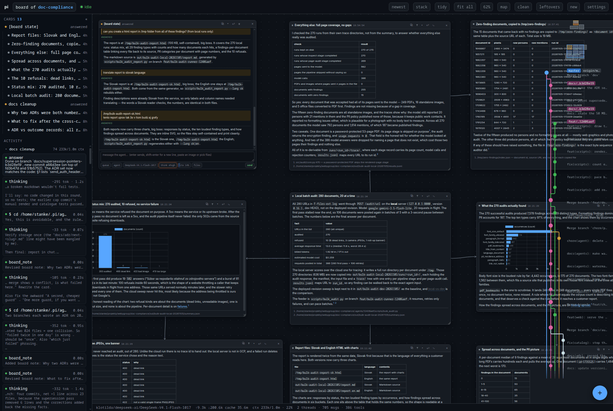

<p align="center">
  
</p>

<h1 align="center">pi-studio</h1>

<p align="center">
  A local daemon that owns pi agents and gives them a board.<br>
  A workspace is a folder. A thread on its board is one agent;<br>
  you type into its card and watch what it does.
</p>

<p align="center">
  
  
  
</p>

<p align="center">
  
  <br>
  <sub>Two threads and the eleven cards they posted beside themselves. The rail on the left is every
       command, edit and thought as it happens; the strip on the right is the branches the threads made.</sub>
</p>

Type into a card and the agent answers there. `steer` puts a correction into a run that is still going,
`queue` waits behind it, and the rail lists what the agent is doing while it does it.

## Run it

```bash
node server.ts            # prints the URL and opens the crossroads in your browser
node server.ts --no-open  # for a service, or when you open it yourself
```

Or, with the repository in `PATH` or linked into `~/.local/bin`:

```bash
pi-studio
```

Node 22.18 or newer runs the `.ts` files directly, and `pi` has to be on the same machine: that is the
whole requirement, given a Node whose build reads TypeScript — a distribution package often does not.
There is no build step and nothing to install.

`npm install` is for the checks only: TypeScript is a dev dependency, and `npm run check` uses it to
type check the code.

### Where Node comes from

On a fresh Ubuntu the system's Node does not run the daemon, on either release, and it fails differently
each time. 24.04 ships Node 18, below the version above, so the first command here answers
`node: command not found` unless another Node is already on the path; pi brings an official one there,
but adds only its own `bin` to the login path. 26.04 ships 22.22, which passes every version check and
still cannot run the daemon, because the distribution builds Node with TypeScript support compiled out:
`node server.ts` answers `Node.js is not compiled with TypeScript support` when asked to strip types,
and `ERR_UNKNOWN_FILE_EXTENSION` when it is not asked. Both read like a fault in this repository.

So the Node to have is an official build — the archive from nodejs.org, or a version manager — and a
machine where pi brought one needs that folder on the path ahead of the distribution's:

```bash
export PATH="$HOME/.local/share/pi-node/current/bin:$PATH"
```

### Two at once

`--state` moves the state folder, which is what lets a development instance run beside the stable one.
Each keeps its own token, port, workspaces, boards and pi sessions, so they cannot read or overwrite
each other:

```bash
pi-studio                                                        # stable
node server.ts --no-open --state ~/.pi/agent/state/pi-studio-dev  # a second one
npm run dev:alt                                                  # the same, watching the code
```

A daemon whose folder is not the usual one names itself after that folder: in its console line, in the
board header next to the workspace, and in the browser tab title (`pi - pi-studio · pi-studio-dev`).
Opening the same repository in both is fine and expected: the board id follows the folder, so both
serve the same board id out of their own folder, with their own threads.

`PI_STUDIO_STATE` does the same as `--state` for anything that would rather set an environment.

### From another computer

`--host 0.0.0.0` (or `PI_STUDIO_HOST`) puts the board on every address the machine answers on, which is
what another computer on the same network needs:

```bash
node server.ts --no-open --host 0.0.0.0
```

or `npm run server`, which is that same line.

The console prints the local link first and then one link per address (`also on http://192.168.…`), so
the line to open on the other machine is already there, token and all. Nothing else changes: the agents,
the files and the saved conversations stay on the machine that runs the daemon, and a tab on any device
watches the same board.

Anyone holding that link can ask an agent to run anything on that machine, and the traffic is plain
http. Keep it to a network you trust, or put a tunnel in front of it. The folder dialog belongs to the
daemon's own screen: from another machine, type the path when it offers the field instead.

## How it works


**Workspaces** are folders you have opened before. The crossroads at `/` lists them, previews the
selected one, and opens it as a board in a tab of its own (`/w/<id>`); asking again reuses that tab.
The folder dialog is the machine's own, through `zenity`. A workspace's board, its threads and their
layout live in `~/.pi/agent/state/pi-studio/boards/<id>.json`.

**Scratch** is the first row of that list. A folder in the machine's temp spot, made again whenever it
is gone, for the question that deserves no project and for the scripts that are all thrash. Its threads
work there directly, because it is not a repository and there is no branch to cut. The `empty` button on
its row stops whatever is running, then deletes the files and the cards and keeps the settings; it asks
twice, and the first press only arms it for four seconds.

**Threads** are cards. A thread is created with `+` and starts its agent on the first message. Its pi
session is written under `~/.pi/agent/state/pi-studio/sessions/<workspace>/`, so a restart of the daemon
resumes the conversation instead of starting over.

**Notes, sources and questions** are what a thread draws beside itself: a table or a chart, a file opened
at the line that matters, a question with buttons it needs answered. The board keeps each one where it
was put.

**Steering** sends into a run in flight, which is the difference between redirecting an agent and
waiting behind it.

**Worktrees** keep the threads out of each other's way. In a repository, each thread works in its own
worktree on a branch of its own, and the strip in the corner of the board draws the branches and the
commits on them.

**A boss thread** spawns children instead of working. It runs one of three flows and gives each child
one role; [docs/boss-and-subagents.md](docs/boss-and-subagents.md) draws the three flows and says what
each role may do.

The daemon listens on loopback only, and every data route needs the token it printed.

## Checks

```bash
npm install     # once, for the checks only; running the daemon needs nothing
npm run check   # syntax, imports, tsc, node --test, then the smoke suite
npm test        # the unit and route tests on their own
npm run smoke   # two daemons against scratch folders; exits 1 on the first failure
```

## Layout

```
server.ts         the entry: reads argv and starts the daemon
server/           the daemon, one module per subject
  main.ts         the request handler and the route table
  routes/         one file per route group, board routes under routes/board/
  store.ts        the boards in memory, on disk, and the three shapes they load from
  cards.ts        the wire shape of a card; bus.ts the fan-out to every open tab
  child/          the `pi` child: its argv, its prompts, its output, its turns
  git/            the repository, the strip's picture, the polling that refreshes it
  worktrees/      making a thread's worktree, naming its branch, retiring it
  paths.ts        every path and the JSON io; types.ts the shapes that cross a boundary
public/           the board client: index.html with its styles, welcome.html for the crossroads
  client/         board.js, and beside it mermaid 11.17.2 and Chart.js 4.6.1, MIT, fetched the
                  first time a card carries a fence they draw
bridge/           the extension a child loads so a thread can draw on its board
bin/pi-studio     the wrapper: one word to start it
bin/smoke.mjs     two daemons against scratch folders, and the routes a change can break
bin/check-imports.mjs  every import resolves, and every client module is served
test/             node --test: the restore paths, git, worktrees, the child, the routes
docs/             settled plans and briefs; docs/media holds the picture above
TODO.md           the one list of what is open: a fix, a feature, a chore
STATE.md          what works, and what does not work yet
```

What is still open lives in [TODO.md](TODO.md); what works, and what does not, is in
[STATE.md](STATE.md).

pi-studio began as the dashboard extension, which was a view of one pi session and could never
supervise more than one agent.
