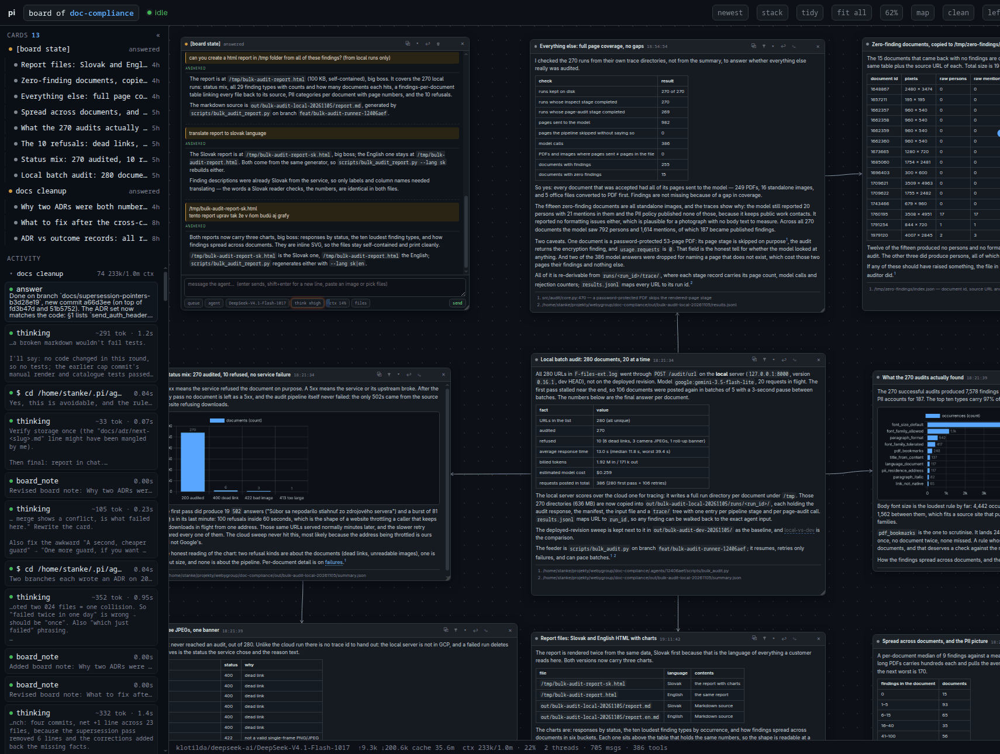
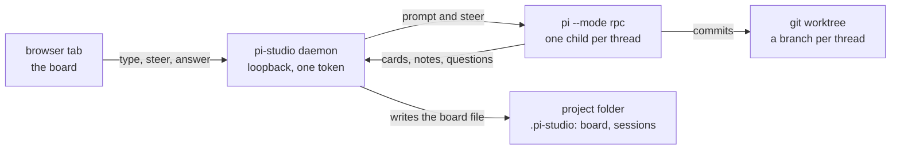

<p align="center">
  
</p>

<h1 align="center">pi-studio</h1>

<p align="center">
  Try it once, and you will never go back to classical chat harness.<br>
  Batteries included.
</p>

<p align="center">
  
  
  
</p>

<p align="center">
  
  <br>
  <sub>Two threads and the eleven cards they posted beside themselves. The rail on the left is every
       command, edit and thought as it happens.</sub>
</p>

Type into a card and the agent answers there. `steer` puts a correction into a run that is still going,
`queue` waits behind it, and the rail lists what the agent is doing while it does it.

## Install it

```bash
curl -fsSL https://github.com/theMladyPan/pi-studio/releases/latest/download/install.sh | sh
pi-studio
```

The script installs the latest release for the current user and nothing else: the app in
`~/.local/share/pi-studio`, one folder per version, and a `pi-studio` command in `~/.local/bin`. It
needs no `sudo`, writes nothing outside your home folder and edits no shell startup file, so
`~/.local/bin` has to be on your `PATH` already for the command to answer. It checks the release's
published sha256 before it installs anything, and a failed check leaves the copy you already had alone.
It installs only the release it names: the archive has to be the official build of that exact version
and tag, and an older release never replaces a newer installed copy.

Node 22.18 or newer has to be on that machine already, and the installer stops without it. `git` and
the `pi` CLI are what threads need, so the run ends with a report of what the board still cannot do:
the three parts it leans on, what was found, and the command that installs what was not. It ships none
of them and installs no npm packages. A release is compiled JavaScript, so the Node you have does not
have to read TypeScript.

```bash
pi-studio doctor
```

That report stays a command of its own, so it can be asked again after anything changes on the
machine, and its exit code is 1 while something is missing: a setup script can ask the same question
without reading the English. `--json` prints the same report as data. The three parts are the Node a
shell would start the command with, git for the repository features, and the pi install a thread is
started from. The graph needs none of them to be found: its page and its client are part of the app.

### From a checkout

```bash
npm ci                    # the locked development dependencies, for the checks and the build
node server.ts            # prints the URL and opens the crossroads in your browser
node server.ts --no-open  # for a service, or when you open it yourself
```

With the repository in `PATH`, `./bin/pi-studio` is the same start in one word.
`npm run install:local` builds the release tree from your own source and installs it the way the
download does. What it installs reads custom, so `pi-studio update` refuses to replace it with a
release until you pass `--replace-custom`. Running the `.ts` sources is the development path and is
the stricter case: that one needs a Node whose build reads TypeScript.

### Where Node comes from

The release needs Node 22.18 or newer and nothing else about it, because the published files are
JavaScript; a distribution build is fine. Running the `.ts` sources is where a fresh Ubuntu fails, and
it fails differently on each release. 24.04 ships Node 18, below the version above, so `node server.ts`
answers `node: command not found` unless another Node is already on the path; pi brings an official one
there, but adds only its own `bin` to the login path. 26.04 ships 22.22, which passes every version
check and still cannot run the sources, because the distribution builds Node with TypeScript support
compiled out: `node server.ts` answers `Node.js is not compiled with TypeScript support` when asked to
strip types, and `ERR_UNKNOWN_FILE_EXTENSION` when it is not asked. Both read like a fault in this
repository.

So the Node to have for the sources is an official build — the archive from nodejs.org, or a version
manager — and a machine where pi brought one needs that folder on the path ahead of the distribution's:

```bash
export PATH="$HOME/.local/share/pi-node/current/bin:$PATH"
```

## Everyday commands

```bash
pi-studio --version                # the version, the commit and whether the build is official
pi-studio plugins reload           # restart every registered plugin in the running daemon, from the file as it stands
pi-studio update                   # the latest official release, checked before it is installed
pi-studio update --replace-custom  # replace a copy you built from your own source
pi-studio uninstall
```

`update` refuses a downgrade, and refuses to replace a custom build unless you ask it to with
`--replace-custom`. The new version is unpacked and tried before anything is switched over, the earlier
version folders stay on disk, and a running daemon keeps running on the old one until you restart it.
`uninstall` refuses while a managed copy is running and removes only what it installed: the version
folders and the launcher. Boards, sessions, prompt edits, the cloned source, Node and `pi` all stay
where they are. None of this uses `sudo` and none of it edits `PATH`.

## What lives where

Two kinds of state, and the difference matters the day a folder moves.

- **The project's own state lives in the project.** The first time a folder is opened, the daemon makes
  `.pi-studio` inside it, holding `board.json`, `sessions/` (one pi transcript per thread) and
  `gitgraph.json`. That folder and `.agents/` are kept out of `git status` through the repository's
  local `info/exclude`, never a tracked `.gitignore`. Worktrees are where they were: a thread works in
  `<repo>/.agents/<id>` on a branch of its own.
- **The machine's records live under XDG state**, in `~/.local/state/pi-studio`: the daemon token and
  port, the list of opened folders, and the prompt edits. `--state <folder>` or `PI_STUDIO_STATE` moves
  that folder only, which is what lets a development instance keep records of its own.

A folder that is moved or cloned elsewhere does not bring its state with it: no path is rewritten, so a
registered folder that is gone reads as missing instead of quietly opening an empty board. One opened
folder has one `.pi-studio`, so two daemons must not work on the same project folder at once. Where
`.pi-studio` cannot be made or written — a read-only folder, a link standing at that path — the board
refuses to open and says why, rather than accepting work it could not save.

Boards and sessions an older pi-studio kept under `~/.pi/agent/state/pi-studio` are imported once, by
copy, the next time their folder is opened: the board, the whole session files and the Git view state,
with ids and history intact. The old files stay where they are. The import is recorded in
`.pi-studio/legacy-import.json` inside the folder and in `legacy-import.json` under the machine's state,
so it happens once; delete that folder's `.pi-studio`, or just those markers, and the next open copies
the old files again.

### A second instance

`--state` moves the machine's records, which is what lets a development instance run beside the stable
one. Each keeps its own token, port and list of folders:

```bash
pi-studio                                                        # stable
node server.ts --no-open --state ~/.pi/agent/state/pi-studio-dev  # a second one
npm run dev:alt                                                  # the same, watching the code
```

A daemon whose folder is not the usual one names itself after that folder: in its console line, in the
board header next to the workspace, and in the browser tab title (`pi - pi-studio · pi-studio-dev`).
The board's id follows the folder, so the same repository opened in both is one board with two daemons
writing the same files — which is why the two instances belong to different folders.

## Prompt edits survive an update

Every prompt the studio ships — the board conventions, the roles, the modes, the flows, the verbosity
and audience files — is edited on its settings page. The edit is kept under the machine's state folder,
with the shipped default it was based on pinned beside it, so an update replaces the defaults and never
your words. When an update changes a prompt you have edited, `pi-studio update` writes a report under
`prompt-update-reports/` that puts your copy, the old default and the new one side by side with diffs.
Nothing is merged and no screen shows it: the report is a file, and a thread can read it and settle each
prompt with you.

## Plugins

A plugin is a program of its own that the daemon starts and talks to over its own pipes. It can read a
board, post notes, drive threads, follow the runs they produce, and put a panel of its own in the toolbox,
drawn in a frame sandboxed away from the board. It runs as you and is handed no token, and the daemon
starts one only when you name it in `~/.local/state/pi-studio/plugins.json`: nothing is installed,
downloaded or asked for, and a folder you open can never register one.

The repository ships no plugin of its own: a row names an executable you already have, or a plugin
folder an install of your own carries. A panel a plugin puts on the board is served by the daemon from
the files that plugin declared, in a frame with no origin of its own.

`docs/plugins.md` has the protocol, the methods a plugin may call, the rules for a panel and how a
package that ships one is staged, and `examples/plugins/scratch-card` is the whole system written in
Rust.

## From another computer

`--host 0.0.0.0` (or `PI_STUDIO_HOST`) puts the board on every address the machine answers on, which is
what another computer on the same network needs:

```bash
node server.ts --no-open --host 0.0.0.0
```

or `npm run server`, which is that same line.

The console prints the local link first and then one link per address (`also on http://192.168.…`), so
the line to open on the other machine is already there, token and all. Nothing else changes: the agents,
the files and the saved conversations stay on the machine that runs the daemon, and a tab on any device
watches the same board.

Anyone holding that link can ask an agent to run anything on that machine, and the traffic is plain
http. Keep it to a network you trust, or put a tunnel in front of it. The folder dialog belongs to the
daemon's own screen: from another machine, type the path when it offers the field instead.

## How it works



**Workspaces** are folders you have opened before. The crossroads at `/` lists them, previews the
selected one, and opens it as a board in a tab of its own (`/w/<id>`); asking again reuses that tab.
The folder dialog is the machine's own, through `zenity`. A workspace's board, its threads and their
layout live in that folder's own `.pi-studio/board.json`, and the list of folders you have opened lives
in the machine's state folder.

**Scratch** is the first row of that list. A folder in the machine's temp spot, made again whenever it
is gone, for the question that deserves no project and for the scripts that are all thrash. Its threads
work there directly, because it is not a repository and there is no branch to cut. The `empty` button on
its row stops whatever is running, then deletes the files and the cards and keeps the settings; it asks
twice, and the first press only arms it for four seconds.

**Threads** are cards. A thread is created with `+` and starts its agent on the first message. Its pi
session is written under the folder's own `.pi-studio/sessions/`, so a restart of the daemon resumes the
conversation instead of starting over.

**Notes, sources and questions** are what a thread draws beside itself: a table or a chart, a file opened
at the line that matters, a question with buttons it needs answered. The board keeps each one where it
was put.

**Steering** sends into a run in flight, which is the difference between redirecting an agent and
waiting behind it.

**Worktrees** keep the threads out of each other's way. In a repository, each thread works in its own
worktree on a branch of its own.

**The whole graph is a drawer away.** In a repository, `g` on the board rolls that repository down over
it as the full graph: every branch, every commit, the commit details pane and the diff. The page and its
client are pi-studio's own, in `public/gitgraph.html` and `public/client/gitgraph/`, so nothing has to be
installed for it and nothing is read out of an editor. A workspace with no repository gets a sentence on
the page instead of a blank drawer, and the rest of the board keeps working.

It speaks the message protocol of [Git Graph Libre](https://github.com/PlohnenSoftware/git-graph-libre)
(PlohnenSoftware, AGPL-3.0-or-later), which in turn descends from
[Git Graph](https://github.com/mhutchie/vscode-git-graph) by Michael Hutchison — the shape of every
command and reply here, and the graph the board draws, come from that lineage. The code is pi-studio's
own; this paragraph is a thank-you, not a licence.

**A boss thread** spawns children instead of working. It decides what the work needs — on `auto` the
steps are its own, and a flow a human pinned is a recipe it follows — and gives each child one role;
[docs/boss-and-subagents.md](docs/boss-and-subagents.md) draws the three flows and says what each role
may do.

The daemon listens on loopback only, and every data route needs the token it printed.

## Checks

```bash
npm ci           # once; the checks and the build use the locked dev dependencies
npm run check    # syntax, imports, tsc, node --test and the smoke suite, run in parallel
npm test         # the unit and route tests on their own
npm run smoke    # two daemons against scratch folders; exits 1 on the first failure
npm run package  # the release assets: the tarball, its .sha256 and install.sh, under release/
```

## Releases

Versions are ZeroVer (`0.MINOR.PATCH`) and the notes for each one are in [CHANGELOG.md](CHANGELOG.md).
Work lands on `dev`; merging `dev` into `main` and tagging that merge with an annotated
`v0.MINOR.PATCH` is what publishes. The tag starts `.github/workflows/release.yml`, which proves the
tag, `package.json` and `package-lock.json` name one version, runs the full check gate, builds
`pi-studio-<version>.tar.gz` with its `.sha256` and `install.sh`, and uploads those three to a draft
release before publishing it as the latest. The notes it publishes are the dated `CHANGELOG.md` section
for that version: a version without one, or whose notes still carry a thread marker such as
`[t-c70e4c65]`, is refused rather than published with a placeholder. A published version is never
replaced: a broken release is repaired with a new version.

## Layout

```
server.ts         the entry: reads argv and starts the daemon
server/           the daemon, one module per subject
  main.ts         the request handler and the route table
  routes/         one file per route group, board routes under routes/board/
  store.ts        the boards in memory, on disk, and the three shapes they load from
  cards.ts        the wire shape of a card; bus.ts the fan-out to every open tab
  child/          the `pi` child: its argv, its prompts, its output, its turns
  git/            the repository
    gitgraph/     the answers the Git Graph page asks for: its dispatch, its reads, its writes
  worktrees/      making a thread's worktree, naming its branch, retiring it
  paths.ts        every path and the JSON io; types.ts the shapes that cross a boundary
public/           the board client: index.html with its styles, welcome.html for the crossroads
  client/         board.js, and beside it mermaid 11.17.2 and Chart.js 4.6.1, MIT, fetched the
                  first time a card carries a fence they draw
  gitgraph.html   the graph page a tab or the drawer loads, its client modules under
                  client/gitgraph/, and the drawer the board rolls down (client/git-drawer.js)
bridge/           the extension a child loads so a thread can draw on its board
bin/pi-studio     the launcher: `--version`, `update`, `uninstall`, then the daemon
bin/manage.mjs    the managed copy: version folders, the update, the uninstall
bin/build-release.mjs  the release build: compiled JavaScript staged into the tree an install copies
bin/install.mjs   `npm run install:local`: build that tree, then install it for this user
bin/smoke.mjs     two daemons against scratch folders, and the routes a change can break
bin/check-imports.mjs  every import resolves, and every client module is served
.github/workflows/release.yml  an annotated version tag checked, built and published
.github/workflows/pages.yml    `site/` published as the project page
test/             node --test: the restore paths, git, worktrees, the child, the routes
docs/             settled plans and briefs; docs/media holds the picture above
TODO.md           the one list of what is open: a fix, a feature, a chore
STATE.md          what works, and what does not work yet
```

What is still open lives in [TODO.md](TODO.md); what works, and what does not, is in
[STATE.md](STATE.md).

pi-studio began as the dashboard extension, which was a view of one pi session and could never
supervise more than one agent.
