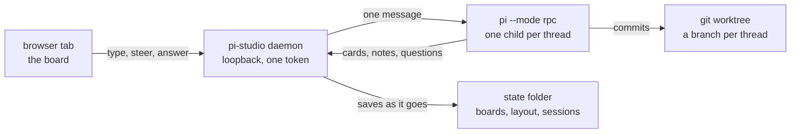

<p align="center">
  
</p>

<h1 align="center">pi-studio</h1>

<p align="center">
  A local daemon that owns pi agents and gives them a board.<br>
  A workspace is a folder. A thread on its board is one agent, working while you watch.
</p>

<p align="center">
  
  
  
  
</p>

<p align="center">
  
  <br>
  <sub>One folder, thirteen threads. Every card is a conversation with its own agent; the rail on the
       left is what the running one is doing, and the strip on the right is the branches the threads made.</sub>
</p>

You type into a card, the agent answers there, and you can steer it while it runs. Everything stays
on your machine: the agents, the files, the saved conversations. It replaces the dashboard extension,
which was a view of a single pi session and could never supervise more than one agent.

## Run it

```bash
node server.ts            # prints the URL and opens the crossroads in your browser
node server.ts --no-open  # for a service, or when you open it yourself
```

Or, with the repository in `PATH` or linked into `~/.local/bin`:

```bash
pi-studio
```

There is no build step and nothing to install to run it. Node 22.18 or newer — where running a `.ts`
file stopped needing a flag — and a working `pi` on the same machine are the whole requirement. The
daemon is TypeScript, and Node strips the types as it loads them.

`npm install` is for the checks only: TypeScript is a dev dependency, and `npm run check` uses it to
type check the code.

## How it works



**Workspaces** are folders you have opened before. The crossroads at `/` lists them, previews the
selected one, and opens it as a board in a tab of its own (`/w/<id>`); asking again reuses that tab.
The folder dialog is the machine's own, through `zenity`. A workspace's board, its threads and their
layout live in `~/.pi/agent/state/pi-studio/boards/<id>.json`.

**The first row is always the scratch one.** A folder in the machine's temp spot, made again whenever
it is gone, for the question that deserves no project and for the scripts that are all thrash. Its
threads work in that folder directly — it is not a repository, so there is no branch to cut — and the
`empty` button on its row stops whatever is still running there, then deletes everything in the folder
and every card on its board. That press asks twice: the first one only arms the button, which turns red
and says `empty?` for four seconds. The board's settings stay.

**Threads** are cards. A thread is created with `+` and starts its agent on the first message. A
thread's pi session is written under `~/.pi/agent/state/pi-studio/sessions/<workspace>/`, so a restart
of the daemon resumes the conversation instead of starting over.

**A thread draws beside itself.** It posts notes with tables and charts, files opened at the line that
matters, and questions with buttons it needs answered. The board keeps each one where it was put.

**Steering** — send with `steer` to redirect a run in flight, or `queue` to wait behind it.

**A boss thread spawns children instead of working.** It runs one of three flows and gives each child
one role; [docs/boss-and-subagents.md](docs/boss-and-subagents.md) draws the three flows and says what
each role may do.

**One client, one visual language.** `public/` holds the board client, carried over from the dashboard
extension when this became its own application. There is no second UI.

The daemon listens on loopback only. The token in the URL guards every data route.

## Two at once

The state folder is one flag away from the usual place, which is what lets a development instance run
beside the stable one. Each instance keeps its own token, its own port, its own workspaces, its own
boards and its own pi sessions, so they cannot read or overwrite each other:

```bash
pi-studio                                   # stable, its own state folder
node server.ts --no-open --state ~/.pi/agent/state/pi-studio-dev   # a second one
npm run dev:alt                             # the same, watching the code
```

A daemon whose folder is not the usual one names itself after that folder: in its console line, in the
board header next to the workspace, and in the browser tab title (`pi - pi-studio · pi-studio-dev`).
Opening the same repository in both is fine and expected: the board id follows the folder, so both
serve the same board id out of their own folder, with their own threads.

`PI_STUDIO_STATE` does the same as `--state` for anything that would rather set an environment.

## From another computer

`--host 0.0.0.0` (or `PI_STUDIO_HOST`) puts the board on every address the machine answers on, which is
what another computer on the same network needs:

```bash
node server.ts --no-open --host 0.0.0.0
```

or `npm run server`, which is that same line.

The console prints the local link first and then one link per address (`also on http://192.168.…`), so
the line to open on the other machine is already there, token and all. Nothing else changes: the agents,
the files and the saved conversations stay on the machine that runs the daemon, and a tab on any device
watches the same board.

The token in that link is the machine — whoever holds it can ask an agent to run anything there — and
the traffic is plain http. Keep it to a network you trust, or put a tunnel in front of it. The folder
dialog belongs to the daemon's own screen: from another machine, type the path when it offers the field
instead.

## Checks

```bash
npm install     # once, for the checks only; running the daemon needs nothing
npm run check   # syntax, the import graph, tsc, node --test, then the smoke suite
npm test        # the unit and route tests on their own
npm run smoke   # boots two daemons against scratch folders, runs its checks, exits 1 on the first failure
```

## Layout

```
server.ts         the entry: reads argv and starts the daemon, nothing else
server/           the daemon, one module per subject
  main.ts         the request handler and the route table
  routes/         one file per route group, board routes under routes/board/
  store.ts        the boards in memory, on disk, and the three shapes they load from
  cards.ts        the wire shape of a card; bus.ts the fan-out to every open tab
  child/          the `pi` child: its argv, its prompts, its output, its turns
  git/            the repository, the strip's picture, the polling that refreshes it
  worktrees/      making a thread's worktree, naming its branch, retiring it
  paths.ts        every path and the JSON io; types.ts the shapes that cross a boundary
public/           the board client: index.html with its styles, welcome.html for the crossroads
  client/         board.js, and the two vendored files beside it: mermaid 11.17.2 and Chart.js 4.6.1,
                  MIT, fetched the first time a card carries a fence they draw and never before that
bridge/           the extension a child loads so a thread can draw on its board
bin/pi-studio     the wrapper: one word to start it
bin/smoke.mjs     boot two daemons against scratch folders and hit the routes a change can break
bin/check-imports.mjs  every import resolves, and every client module is served
test/             node --test: the restore paths, git, worktrees, the child, the routes
docs/             settled plans and briefs; docs/media holds the picture in this README
TODO.md           the one list of what is open: a fix, a feature, a chore
STATE.md          what works, and what does not work yet
```

## What it does not do yet

Usage totals beside a rail row's detail sheet, and a screenshot's picture after the daemon restarts.
[TODO.md](TODO.md) keeps the whole list of what is open, and [STATE.md](STATE.md) says what works.
